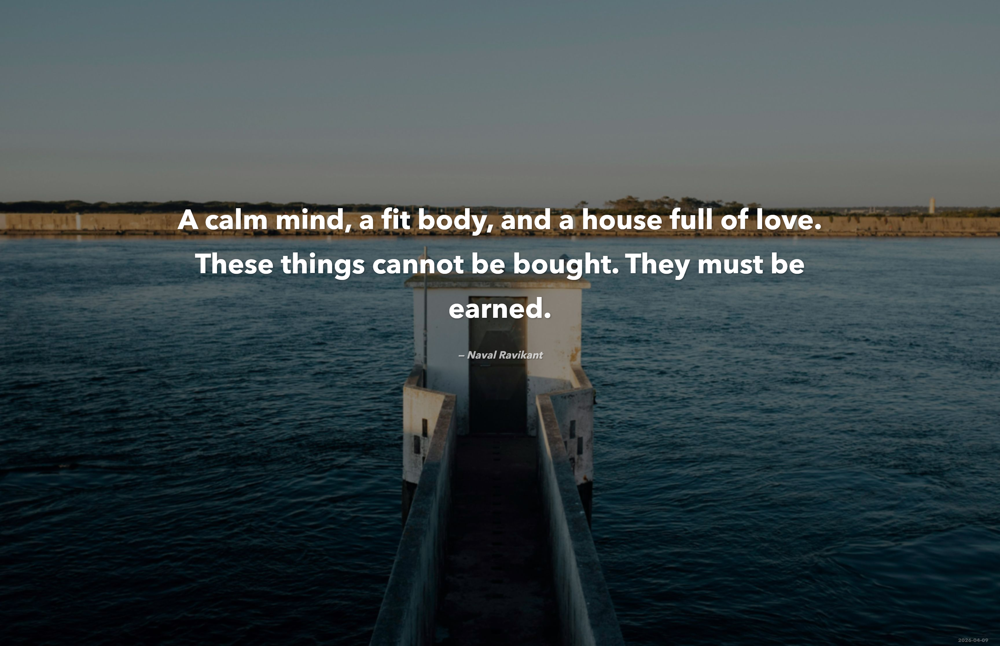

# Inspiration

**A daily inspirational quote wallpaper generator that runs on macOS, Windows, and Linux/ChromeOS.**

Inspiration picks a new quote each morning, pairs it with a beautiful photograph from Unsplash, composites them into a wallpaper, and sets it as your desktop background -- automatically. It ships with 10 curated quote collections spanning Zen, Stoicism, Rumi, Naval Ravikant, Alan Watts, and more.

<p align="center">
  
</p>

---

## Table of Contents

- [Features](#features)
- [Quick Start](#quick-start)
- [Platform Setup](#platform-setup)
  - [macOS](#macos)
  - [Windows](#windows)
  - [Linux / ChromeOS](#linux--chromeos)
- [Web UI](#web-ui)
- [Configuration](#configuration)
  - [Quote Sources](#quote-sources)
  - [Display Settings](#display-settings)
  - [Adding Your Own Quotes](#adding-your-own-quotes)
- [Scheduling](#scheduling)
- [Architecture](#architecture)
- [Project Structure](#project-structure)
- [Troubleshooting](#troubleshooting)
- [License](#license)

---

## Features

- **Daily quote rotation** -- deterministic per day so every device shows the same quote
- **Unsplash backgrounds** -- fetched automatically based on the quote collection's theme
- **Cross-platform** -- native wallpaper setting on macOS, Windows, and Linux (GNOME, KDE, XFCE)
- **Web UI** -- local dashboard to preview, shuffle, configure sources, and manage scheduling
- **iPhone export** -- generate a matching phone wallpaper from the web UI
- **Archive** -- every wallpaper is saved to `~/Pictures/DailyQuotes`
- **Caching** -- backgrounds and rendered wallpapers are cached to avoid redundant API calls
- **Bundled fallback font** -- works even without Avenir Next, Segoe UI, or other OS-specific fonts
- **Scheduler support** -- launchd (macOS), Task Scheduler (Windows), cron (Linux/ChromeOS)

---

## Quick Start

### Prerequisites

- [Node.js](https://nodejs.org/) v18 or later
- A free [Unsplash API key](https://unsplash.com/developers)

### Install

```bash
git clone https://github.com/YOUR_USERNAME/inspiration.git
cd inspiration
npm install
```

### Configure

```bash
cp .env.example .env
```

Open `.env` and paste your Unsplash access key:

```
UNSPLASH_ACCESS_KEY=your_access_key_here
```

### Run

```bash
npm run generate
```

That's it. Your desktop wallpaper should change within a few seconds.

---

## Platform Setup

### macOS

Works out of the box. The wallpaper is set via AppleScript. On first run you may see a prompt:

> **System Settings > Privacy & Security > Automation** -- allow Terminal (or your terminal app) to control System Events.

To run daily at 7 AM:

```bash
bash scripts/install-launchd.sh
```

### Windows

Works out of the box. The wallpaper is set via the Win32 `SystemParametersInfo` API through PowerShell.

To run daily at 7 AM (run PowerShell as Administrator):

```powershell
powershell -ExecutionPolicy Bypass -File scripts\install-task-scheduler.ps1
```

### Linux / ChromeOS

The wallpaper setter auto-detects your desktop environment and tries, in order:

1. **GNOME / ChromeOS Crostini** (`gsettings`)
2. **KDE Plasma** (`qdbus`)
3. **XFCE** (`xfconf-query`)
4. **feh** (common on tiling window managers)

To run daily at 7 AM:

```bash
bash scripts/install-cron.sh
```

> **ChromeOS note:** Enable the Linux development environment in Settings, then follow the Linux instructions inside the terminal.

---

## Web UI

Launch the local dashboard:

```bash
npm run ui
```

This opens `http://localhost:3456` in your browser with five tabs:

| Tab | What it does |
|---|---|
| **Today** | Preview the current wallpaper, generate a new one, shuffle quotes, or export an iPhone wallpaper |
| **Archive** | Browse all previously generated wallpapers as a thumbnail grid |
| **Sources** | Toggle quote collections on or off |
| **Settings** | Adjust darken opacity, blur, fonts, and multi-display mode |
| **Schedule** | View scheduler status, install or uninstall the daily schedule |

---

## Configuration

### `data/config.json`

```jsonc
{
  "activeSources": ["naval", "zen", "stoicism", ...],  // which quote collections to use
  "resolution": { "width": 3456, "height": 2234 },     // output wallpaper resolution
  "font": {
    "quote": "Avenir Next",          // font for the quote text
    "attribution": "Avenir Next"     // font for the author line
  },
  "background": {
    "darkenOpacity": 0.45,           // how much to darken the photo (0-1)
    "blurSigma": 2                   // gaussian blur radius (0 = none)
  },
  "archivePath": "~/Pictures/DailyQuotes",  // where to save wallpapers
  "setAllDisplays": true,            // set wallpaper on all monitors (macOS)
  "scheduledTime": {
    "hour": 7,                       // 24-hour clock hour for the daily run
    "minute": 0                      // minute for the daily run
  }
}
```

> **Tip:** Adjust `resolution` to match your display. Common values:
> - **1080p**: `1920 x 1080`
> - **1440p**: `2560 x 1440`
> - **4K**: `3840 x 2160`
> - **MacBook Pro 14"**: `3024 x 1964`
> - **MacBook Pro 16"**: `3456 x 2234`

### Quote Sources

Each JSON file in `data/quotes/` is a self-contained collection:

| Source | Author(s) | Theme |
|---|---|---|
| `naval.json` | Naval Ravikant | technology, calm ocean |
| `zen.json` | Zen proverbs | zen garden, minimal nature |
| `stoicism.json` | Marcus Aurelius, Seneca, Epictetus | ancient columns, marble |
| `rumi.json` | Rumi | Persian art, cosmic sky |
| `watts.json` | Alan Watts | flowing water, mountains |
| `musashi.json` | Miyamoto Musashi | Japanese ink painting |
| `emerson.json` | Ralph Waldo Emerson | New England forest |
| `buddha.json` | Buddha, Thich Nhat Hanh | lotus, temple |
| `laotzu.json` | Lao Tzu | mist, mountain path |
| `brown.json` | Brene Brown | warm light, connection |

### Adding Your Own Quotes

Create a new JSON file in `data/quotes/`:

```json
{
  "id": "myquotes",
  "name": "My Favorites",
  "theme": "sunset ocean peaceful",
  "quotes": [
    { "text": "Your quote here.", "author": "Author Name" },
    { "text": "Another quote.", "author": "Another Author" }
  ]
}
```

Then add `"myquotes"` to the `activeSources` array in `data/config.json` (or toggle it on in the web UI).

The `theme` field is used as a search query for Unsplash background images -- pick 2-4 descriptive words that match the mood you want.

---

## Scheduling

| Platform | Method | Install | Uninstall |
|---|---|---|---|
| macOS | launchd | `bash scripts/install-launchd.sh` | `bash scripts/install-launchd.sh uninstall` |
| Windows | Task Scheduler | `powershell scripts\install-task-scheduler.ps1` | `powershell scripts\install-task-scheduler.ps1 -Uninstall` |
| Linux/ChromeOS | cron | `bash scripts/install-cron.sh` | `bash scripts/install-cron.sh uninstall` |

You can configure the daily run time from the **Schedule** tab in the [web UI](#web-ui) — pick any hour and minute and click **Save Time**. The setting is stored in `data/config.json` and applied the next time you (re)install the scheduler.

To change the time without the web UI, edit `scheduledTime` in `data/config.json` directly, then reinstall the scheduler for your platform.

---

## Architecture

The generation pipeline runs in a single pass:

```
1. Load config          Read data/config.json + .env
        |
2. Select quote         Hash today's date -> deterministic index into the quote pool
        |
3. Check cache          Skip to step 7 if today's wallpaper already exists
        |
4. Fetch background     Unsplash API (themed search) -> cached to ~/.cache/inspiration/
        |
5. Render wallpaper     sharp (resize/blur/darken) + @napi-rs/canvas (text overlay)
        |
6. Archive              Save PNG to ~/Pictures/DailyQuotes/YYYY-MM-DD_HHMMSS.png
        |
7. Set wallpaper        Platform-specific: AppleScript | PowerShell | gsettings/feh
```

The **web UI** (`npm run ui`) wraps this same pipeline behind a local HTTP server with a REST API, adding shuffle, iPhone export, and settings management.

---

## Project Structure

```
inspiration/
|-- data/
|   |-- config.json              # User configuration
|   |-- fonts/
|   |   |-- Inter-Regular.ttf    # Bundled fallback font
|   |-- quotes/
|       |-- naval.json           # Quote collections (one per file)
|       |-- zen.json
|       |-- ...
|-- scripts/
|   |-- install-launchd.sh       # macOS scheduler (launchd)
|   |-- install-cron.sh          # Linux/ChromeOS scheduler (cron)
|   |-- install-task-scheduler.ps1  # Windows scheduler (Task Scheduler)
|-- src/
|   |-- index.ts                 # CLI entry point -- runs the full pipeline
|   |-- server.ts                # Web UI server (HTTP + REST API)
|   |-- config.ts                # Loads and merges config + env vars
|   |-- ui.html                  # Single-page web UI (served by server.ts)
|   |-- canvas/
|   |   |-- fonts.ts             # Cross-platform font registration
|   |   |-- renderer.ts          # Composites background + text into final wallpaper
|   |   |-- textLayout.ts        # Word-wrapping and font-size fitting
|   |-- images/
|   |   |-- cache.ts             # Cache directory management and cleanup
|   |   |-- unsplash.ts          # Unsplash API client
|   |-- quotes/
|   |   |-- loader.ts            # Loads quote files and selects daily/random quote
|   |   |-- types.ts             # TypeScript interfaces for quotes
|   |-- utils/
|   |   |-- date.ts              # Date formatting and hashing
|   |   |-- platform.ts          # OS detection and cross-platform helpers
|   |-- wallpaper/
|       |-- archive.ts           # Saves rendered wallpapers to the archive folder
|       |-- setter.ts            # Sets the desktop wallpaper (macOS/Windows/Linux)
|-- .env.example                 # Template for Unsplash API key
|-- package.json
|-- tsconfig.json
```

---

## Troubleshooting

### "UNSPLASH_ACCESS_KEY is required"

Copy `.env.example` to `.env` and add your key from [unsplash.com/developers](https://unsplash.com/developers). The free tier allows 50 requests/hour.

### Wallpaper doesn't change (macOS)

Go to **System Settings > Privacy & Security > Automation** and ensure your terminal app has permission to control **System Events**.

### Wallpaper doesn't change (Linux)

Make sure one of the supported desktop environments is running (GNOME, KDE, XFCE) or that `feh` is installed. You can test manually:

```bash
gsettings set org.gnome.desktop.background picture-uri "file:///tmp/test.png"
```

### Fonts look different on another machine

The app auto-detects system fonts per platform (Avenir Next on macOS, Segoe UI on Windows, DejaVu Sans on Linux). If none are found, it falls back to the bundled **Inter** font. You can override the font in `data/config.json` or via the web UI Settings tab.

### Canvas build errors on install

The `@napi-rs/canvas` package includes prebuilt native binaries. If your platform isn't supported, you may need to install build tools:

- **Windows**: `npm install --global windows-build-tools`
- **Linux**: `sudo apt install build-essential libcairo2-dev libjpeg-dev libpango1.0-dev libgif-dev`

---

## License

MIT
